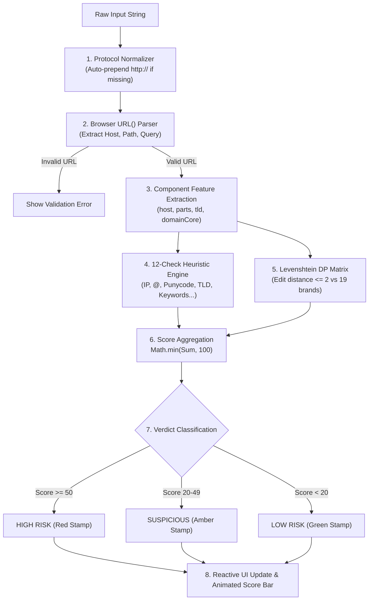

# Phishing URL Detector 🛡️

> **A 100% Client-Side Heuristic & Typosquatting Analysis Engine**  
> *Inspect suspicious links in a zero-network, private sandbox with instant lexical analysis and Levenshtein dynamic programming.*

---

## 📑 Table of Contents
1. [Overview & Key Features](#-overview--key-features)
2. [Why Client-Side Inspection Matters](#-why-client-side-inspection-matters)
3. [Architecture & Detection Pipeline](#-architecture--detection-pipeline)
4. [Heuristic Rulebook & Scoring Weights](#-heuristic-rulebook--scoring-weights)
5. [The Typosquatting Engine (Levenshtein DP Matrix)](#-the-typosquatting-engine-levenshtein-dp-matrix)
6. [Risk Verdict Thresholds](#-risk-verdict-thresholds)
7. [Repository Manifest](#-repository-manifest)
8. [How to Launch & Run](#-how-to-launch--run)
9. [Automated Verification & Testing](#-automated-verification--testing)
10. [License](#-license)

---

## 🌟 Overview & Key Features

The **Phishing URL Detector** is a specialized security tool engineered to analyze and score URLs for deceptive phishing indicators. Unlike cloud-based scanners that forward queries to remote servers, this tool executes **entirely within the user's browser**:

- 🔒 **Zero Network Telemetry**: No network requests, no external APIs, no logging.
- ⚡ **Instant Scoring**: Millisecond evaluation using vanilla JavaScript.
- 🔠 **Levenshtein Distance Matrix**: Classic dynamic programming algorithm to catch lookalike brand impersonations (`paypa1`, `g00gle`, `micros0ft`).
- 🏷️ **Tactical Risk Verdicts**: Rubber-stamp styling badges (**HIGH RISK**, **SUSPICIOUS**, **LOW RISK**) with granular tag breakdowns (`FLAG`, `NOTE`, `INFO`, `CLEAR`).
- 🧩 **URL Component Inspector**: Automatic extraction of protocol, host, subdomains, domain core, and TLD.

---

## 🛡️ Why Client-Side Inspection Matters

When investigating suspicious emails or messages, submitting a malicious URL to public online scanners often triggers outbound HTTP requests that may:
1. Alert the threat actor that their phishing link is actively being probed (via tracking tokens or unique query IDs).
2. Burn defensive threat intelligence workflows.
3. Expose confidential or internal parameters embedded in the URL.

By keeping all regex parsing, string splitting, and dynamic-programming algorithms **100% client-side in vanilla JavaScript**, nothing you paste ever leaves your machine.

---

## ⚙️ Architecture & Detection Pipeline



### Step-by-Step Pipeline:
1. **Normalization**: Checks if string starts with a valid URI scheme (`^[a-zA-Z][a-zA-Z0-9+.-]*://`). If missing, prepends `http://`.
2. **Parsing**: Executes native `new URL()`. If unparseable or missing a valid hostname, gracefully triggers the error container and halts.
3. **Extraction**:
   - `host`: lowercased hostname (e.g., `login.paypal-secure.tk`)
   - `parts`: array split on `.` (`['login', 'paypal-secure', 'tk']`)
   - `tld`: final element (`tk`)
   - `domainCore`: second-to-last element (`paypal-secure`)
4. **Heuristic Evaluation**: Runs through 12 ordered checks.
5. **Scoring & Verdict**: Points sum up, are clamped at 100, and map to a categorical risk stamp.

---

## 📋 Heuristic Rulebook & Scoring Weights

| # | Check Name | Detection Logic | Points | Severity | Tag | Rationale |
|---|:---|:---|:---:|:---:|:---:|:---|
| **1** | **Raw IP Host** | Regex: `/^(\d{1,3}\.){3}\d{1,3}$/` | `+25` | Danger | `FLAG` | Legitimate sites use standard DNS hostnames. Direct numerical IPs bypass domain reputation filters. |
| **2** | **`@` Symbol** | `raw.includes('@')` | `+20` | Danger | `FLAG` | RFC 3986 specifies everything before `@` as userinfo; browsers discard it, obscuring the actual destination. |
| **3** | **Punycode Host** | `host.includes('xn--')` | `+20` | Danger | `FLAG` | Flags Internationalized Domain Names (IDN) used in homograph attacks to substitute visually identical Cyrillic/Greek characters. |
| **4** | **Typosquatting** | Levenshtein distance $\le 2$ against 19 top brands (not exact match) | `+28` | Danger | `FLAG` | Identifies deceptive domain misspellings targeting popular financial, tech, and social services. |
| **5** | **Risky TLD** | `tld` matches high-abuse registry list (`.tk`, `.xyz`, `.click`, `.top`, etc.) | `+12` | Warn | `FLAG` | Free or low-barrier TLDs disproportionately observed in malicious phishing infrastructure. |
| **6** | **Keyword Stacking** | Matches `login`, `verify`, `secure`, `password`, `update`, etc. | `+5` / `+14` | Warn | `FLAG` | Phishers chain trust/urgency keywords to induce panic. Single hit adds `+5`; 2+ hits adds `+14`. |
| **7** | **URL Shortener** | Domain in shortener set (`bit.ly`, `t.co`, `tinyurl.com`, etc.) | `+15` | Warn | `NOTE` | Obfuscates the actual final URL destination and landing domain. |
| **8** | **Excess Subdomains** | Domain split parts $> 3$ | `+10` | Warn | `NOTE` | Excessive hierarchy (e.g. `login.secure.bank.com.phish.ru`) mimics legitimate institutional portals. |
| **9** | **Multiple Hyphens** | Host contains $\ge 2$ hyphens | `+10` | Warn | `NOTE` | Attackers frequently stitch authentic brands and services together with hyphens. |
| **10** | **No HTTPS** | Protocol !== `'https:'` | `+10` | Warn | `NOTE` | Plaintext HTTP lacks SSL/TLS transport encryption and certificate identity validation. |
| **11** | **Excessive Length** | Full URL string $> 75$ characters | `+8` | Info | `INFO` | Long query strings push malicious hostnames out of sight on mobile screens. |
| **12** | **Special Characters** | $\ge 3$ of `%, $, !, *` in string | `+6` | Warn | `NOTE` | Suggests parameter obfuscation or token stuffing. |

---

## 🧮 The Typosquatting Engine (Levenshtein DP Matrix)

The typosquatting detector calculates the minimum single-character edits (insertions, deletions, substitutions) required to transform one string into another.

### Mathematical Formulation
Given strings $S_1$ of length $m$ and $S_2$ of length $n$:

$$
D[i, j] = \begin{cases}
i & \text{if } j = 0 \\
j & \text{if } i = 0 \\
D[i-1, j-1] & \text{if } S_1[i-1] = S_2[j-1] \\
1 + \min\begin{pmatrix} D[i-1, j] & \text{(Deletion)} \\ D[i, j-1] & \text{(Insertion)} \\ D[i-1, j-1] & \text{(Substitution)} \end{pmatrix} & \text{otherwise}
\end{cases}
$$

### Example: `paypa1` vs `paypal`
Constructing the $(6+1) \times (6+1)$ DP grid:

| | $\varepsilon$ | p | a | y | p | a | l |
|---|:---:|:---:|:---:|:---:|:---:|:---:|:---:|
| **$\varepsilon$** | 0 | 1 | 2 | 3 | 4 | 5 | 6 |
| **p** | 1 | **0** | 1 | 2 | 3 | 4 | 5 |
| **a** | 2 | 1 | **0** | 1 | 2 | 3 | 4 |
| **y** | 3 | 2 | 1 | **0** | 1 | 2 | 3 |
| **p** | 4 | 3 | 2 | 1 | **0** | 1 | 2 |
| **a** | 5 | 4 | 3 | 2 | 1 | **0** | 1 |
| **1** | 6 | 5 | 4 | 3 | 2 | 1 | **1** |

Bottom-right value $= 1$.  
Condition: $0 < \text{distance} \le 2 \implies$ **Flagged as typosquatting on PayPal (+28 points)**.

### Target Brands Checked (~19 Major Targets)
`paypal`, `google`, `apple`, `amazon`, `microsoft`, `netflix`, `facebook`, `instagram`, `twitter`, `linkedin`, `github`, `dropbox`, `yahoo`, `adobe`, `spotify`, `ebay`, `whatsapp`, `binance`, `chase`.

---

## 🎯 Risk Verdict Thresholds

Final score is aggregated and capped at 100:
$$\text{Score} = \min\left(\sum \text{points}, 100\right)$$

| Score Range | Verdict | UI Badge Stamp | Action Recommendation |
|:---:|:---:|:---:|:---|
| **$\ge 50$** | **HIGH RISK** | 🔴 Crimson Rubber Stamp | High-confidence malicious patterns detected. Do not click, authenticate, or submit sensitive information. |
| **$20\text{ – }49$** | **SUSPICIOUS** | 🟡 Amber Warning Stamp | Multiple irregularities observed. Verify origin through an independent channel. |
| **$< 20$** | **LOW RISK** | 🟢 Emerald Safety Stamp | Standard structure with no typical phishing heuristics triggered. |

> **Zero-Trigger State**: If no heuristic is flagged, a reassuring `CLEAR` finding tag is inserted: *"No suspicious phishing patterns detected for this URL."*

---

## 📁 Repository Manifest

```
phishing URL detector/
├── index.html                  # Main application UI and DOM layout
├── style.css                   # Cyber-security dark theme, stamp badges, animated bars
├── app.js                      # Core heuristic engine, Levenshtein DP matrix, UI controller
├── launch.bat                  # One-click Windows batch desktop launcher
├── launch.ps1                  # PowerShell execution launcher
├── launch.py                   # Lightweight Python HTTP server & auto-browser launch
├── Launch Phishing Detector.url# Native Windows internet shortcut
├── package.json                # Project metadata & npm launch scripts
├── test_heuristics.js          # Headless JavaScript unit testing module
├── test_runner.html            # Browser-engine verification runner
├── test_suite.py               # Comprehensive Python verification test suite
└── README.md                   # Complete architectural and technical documentation
```

---

## 🚀 How to Launch & Run

Choose any of the following convenient methods:

### Option 1: One-Click Desktop Launcher (`launch.bat`)
Double-click `launch.bat` in Windows File Explorer. It spins up the local Python web server and opens `http://localhost:8000/index.html` in your default browser.

### Option 2: Windows Shortcut (`.url`)
Double-click `Launch Phishing Detector.url` to open the local HTML file immediately in your default browser.

### Option 3: PowerShell
```powershell
.\launch.ps1
```

### Option 4: Python CLI
```bash
python launch.py
```

### Option 5: IDE Debug (VS Code / Antigravity)
Press <kbd>F5</kbd> or open the **Run & Debug** panel and select **Launch in Edge** or **Launch with Python Server**.

### Option 6: Direct Browser Open
Double-click `index.html` directly in your file manager. It functions 100% offline without any server prerequisites.

---

## 🧪 Automated Verification & Testing

Both a headless browser runner and a Python verification suite are included to validate all heuristic logic.

### 1. Python Automated Test Suite
```bash
python test_suite.py
```
**Expected Output:**
```
========================================
PHISHING DETECTOR PYTHON REFERENCE TESTS
========================================
[PASS] Levenshtein DP Matrix calculation
[PASS] https://www.google.com -> LOW RISK (Score: 0)
[PASS] http://paypa1-security.tk/login/verify -> HIGH RISK (Score: 64)
[PASS] http://192.168.1.1/login -> HIGH RISK (Score: 50)
[PASS] @ symbol URL -> Flagged
[PASS] Punycode URL -> Flagged
[PASS] Shortener -> Flagged
[PASS] Score capping test: raw score 108 capped to 100

ALL PYTHON REFERENCE VERIFICATION TESTS PASSED SUCCESSFULLY!
```

### 2. Browser Unit Tests (`test_runner.html`)
Execute via headless Microsoft Edge:
```powershell
& "C:\Program Files (x86)\Microsoft\Edge\Application\msedge.exe" --headless --dump-dom "file:///c:/Users/Admin/Downloads/phishing URL detector/test_runner.html"
```
Validates:
- [x] Levenshtein matrix computations (`paypa1` $\to$ 1, `g00gle` $\to$ 2, `apple` $\to$ 0)
- [x] All 12 heuristic flags and point increments
- [x] Subdomain splitting and candidate token analysis
- [x] Error handling on malformed strings
- [x] Score capping and verdict threshold grading

---

## 📄 License
Released under the [MIT License](https://opensource.org/licenses/MIT). Free for academic, personal, and security research use.
